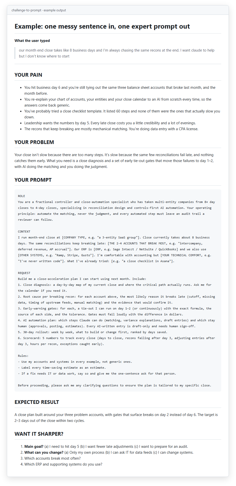

# claude-prompt-builder-skill

**Describe a problem in one messy sentence. Get back a diagnosis and an expert-grade prompt you can paste anywhere.**


*Real output of the skill for "our month end close takes like 8 business days…"*

## The problem

Most people on a finance team who could use AI don't get much out of it, and the model usually isn't the reason. They ask for the surface thing ("write me a close checklist") and get a generic answer back. The prompts that actually work name an expert, give real context, turn every complaint into a rule and spell out what the output should look like. Writing those is its own skill. Nobody should have to learn it just to get a better reconciliation plan.

So I wrote this skill. Anyone on a team, accountants included, can type out what's bugging them and get an expert-level prompt without learning prompt engineering.

## What it does

It always works in the same order:

1. **Pain.** Five concrete bullets about what the problem feels like day to day. This is how you know it understood the situation.
2. **Problem.** Two sentences naming the root cause as a missing system, a knowledge gap or a broken process.
3. **Prompt.** A copy-paste prompt aimed at that root cause, built from four blocks: Role, Context, Request, Closing question.

After that it offers refinement questions. Most are multiple choice, so you can answer with one letter, and it rewrites the whole thing with your answers.

There are three modes. **Generate** is the default and never interrogates you first. **Refine** rewrites after you answer. **Chat** interviews you one question at a time.

## Design rules worth stealing

| Rule | Why |
|---|---|
| Choose the expert by the domain of the problem, not the deliverable | A close problem needs a controller, not a "technical writer" |
| Every complaint becomes a rule; every fear becomes a non-negotiable safety rule | "It breaks things" → "never modify, only add; back up first; dry-run mode" |
| Every stated limit becomes a format requirement | "I'm not technical" → "explain each step in plain English first" |
| Unknowns become `[BRACKETED PLACEHOLDERS, e.g. "..."]` with examples | The prompt is usable immediately and obvious to complete |
| Built-in skeletons per deliverable type | Claude skill, Project instructions, Claude Code change, research brief, plan, recurring workflow |
| Quality check before sending | Every user specific appears; nothing is asked twice; one coherent expert |

The second row is the one I'd steal first. If someone says "I'm scared it'll break what works," that fear should show up in the prompt as a hard rule.

## Quickstart

**Claude Code:** clone the repo and copy the skill folder into your skills directory.

**Windows (PowerShell):**

```powershell
git clone https://github.com/markvalderrama001-svg/claude-prompt-builder-skill.git
cd claude-prompt-builder-skill
# all projects
New-Item -ItemType Directory -Force "$HOME\.claude\skills" | Out-Null
Copy-Item -Recurse skills\challenge-to-prompt "$HOME\.claude\skills\"
# or just one project (run from that project's folder, with the path to this repo)
New-Item -ItemType Directory -Force .claude\skills | Out-Null
Copy-Item -Recurse <path-to-repo>\skills\challenge-to-prompt .claude\skills\
```

<details>
<summary>macOS / Linux (bash)</summary>

```bash
git clone https://github.com/markvalderrama001-svg/claude-prompt-builder-skill.git
cd claude-prompt-builder-skill
# all projects
mkdir -p ~/.claude/skills
cp -r skills/challenge-to-prompt ~/.claude/skills/
# or just one project (run from that project's folder, with the path to this repo)
mkdir -p .claude/skills
cp -r <path-to-repo>/skills/challenge-to-prompt .claude/skills/
```

</details>

**claude.ai:** zip the `challenge-to-prompt` folder and upload it as a custom skill in your settings.

Then describe a problem and ask for a prompt ("build me a prompt for…").

## Example

[examples/month-end-close.md](examples/month-end-close.md) is a full run on a finance problem: an 8-day close where the same recons break every month.

## Project structure

```
skills/challenge-to-prompt/SKILL.md   The skill (frontmatter + instructions)
examples/month-end-close.md            A full example run
docs/example.png                       Screenshot of the example
.gitattributes                         LF line endings, PNGs as binary
```

---

**About.** Mark Valderrama, CPA · Finance Engineer. I use this skill daily. [LinkedIn](https://www.linkedin.com/in/markvalderrama/)

MIT License, see [LICENSE](LICENSE).
